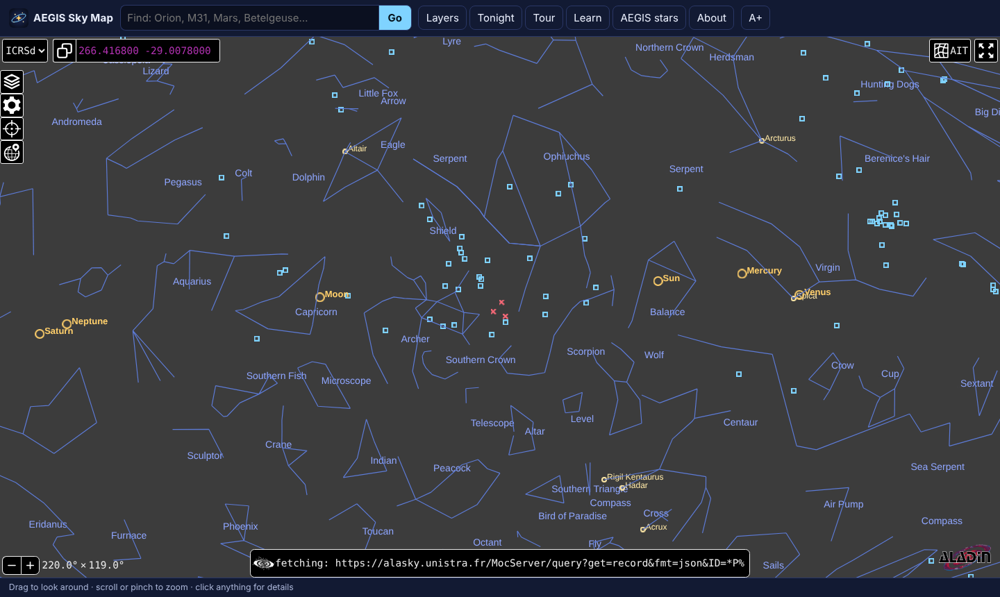

# AEGIS Sky Map

A free, interactive map of the whole sky for classrooms and curious people. Open it in a browser and you can:

- **Look at real telescope surveys** of the entire sky — visible light, infrared, microwaves (Planck), gamma rays (Fermi), and the
  Gaia map of 1.8 billion stars — and switch between them on the same patch of sky.
- **Find things**: 88 constellations with their figures and names, 378 named stars, all 110 Messier galaxies, nebulae and
  clusters, and the Sun, Moon and planets where they are right now (or at any date you choose).
- **See tonight's sky** for your town: which planets are up, when they rise and set, how full the Moon is.
- **Take a 10-stop guided tour** (Orion, a star nursery, the galactic centre in infrared, Andromeda, the microwave sky…).
- **Learn**: six short lessons and three ready-to-run classroom activities.
- **Help check real data**: the AEGIS Star Mapper re-verified 192,208,838 Gaia stars against ESA's archive and flags unusual
  ones. Students open a flagged star, read why it was flagged, and record their own review (kept on the device; exportable as CSV).

No accounts, no tracking, no ads. Works on Chromebooks, Windows, Mac, iPad and phones, and installs as an app.

## Start it
- **Quickest:** double-click `START_SKY_MAP.bat` (Windows) or run `sh start_sky_map.sh` (Mac/Linux). Needs Python 3, nothing else.
- **For a whole school:** put this folder on any web server or school intranet, or host it free on GitHub Pages. See [INSTALL.md](INSTALL.md).
- Teachers: see [TEACHERS.md](TEACHERS.md).

The app itself works offline once loaded. The telescope pictures stream from the CDS archive in Strasbourg, so they need internet;
without it, the drawn layers (constellations, stars, Messier objects, planets, AEGIS stars), Tonight, Tour and Learn still work.

## The Star Mapper ↔ Sky Map loop
The map and the AEGIS Star Mapper feed each other:

1. **Mapper → map.** On the Star Mapper computer run `START_MAP_FEED.bat` in `ufe-v2/` (or `python -m aegis.map_feed`). It reads the
   sweep (never changes it) and writes the map's data: survey coverage, flagged stars, and seven **discovery categories** —
   the Sun's neighbours, white-dwarf candidates, luminous giants, fast movers, hypervelocity candidates, strong wobblers and very
   red stars (rules fixed in advance in `field_tests/rules/PREREG_D716_*`; every entry is a candidate).
2. **Map → people.** Students open those stars, read why each one is interesting, and vote.
3. **People → mapper.** Teachers download the class's votes (AEGIS stars → Download CSV) and drop the file into
   `ufe-v2/cosmos_map/reviews_in/`. The next map feed tallies them, writes `cosmos_map/recheck_priority.json` (the stars reviewers
   think look real, most-supported first) for the mapper's follow-up, and shows every class the combined tallies on the map.

The monitor also serves the map with this computer's data at `http://localhost:8765/skymap`.

## For developers
Plain HTML, CSS and ES modules, no build step. `vendor/` holds Aladin Lite 3.8.2 (CDS, LGPL-3) and astronomy-engine 2.1.19 (MIT);
`tools/build_reference_data.py` rebuilds the constellation/star/Messier files from d3-celestial (BSD-3).
Tests: `pytest apps/skymap/tests` (the browser test needs Playwright). Release zip: `python tools/package_release.py`.

## Licence
AGPL-3.0-or-later — free for schools, students and everyone ([LICENSE](LICENSE)); commercial licence for organisations that
don't want the AGPL's obligations ([COMMERCIAL.md](COMMERCIAL.md)). Third-party parts: [THIRD_PARTY_NOTICES.md](THIRD_PARTY_NOTICES.md).
© 2026 Danny Lee Eldridge. Built with AI assistance (Claude, Anthropic).
