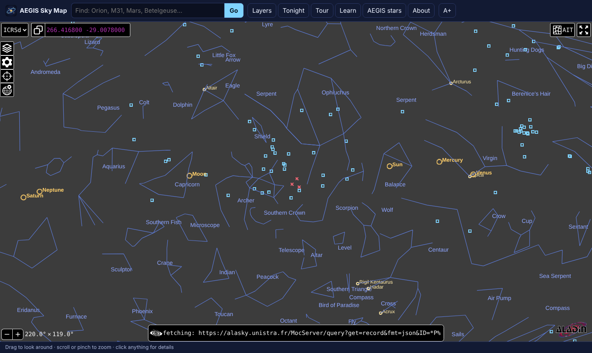

> **The Lantern**
>
> In a world of painted walls and borrowed light,
> where lies wear crowns and illusions call themselves the sky,
> this work is a lantern, not a throne.
> It was carried, not crowned.
> It asks for no bowed heads, only open eyes:
> take it, test it, and see for yourself.
>
> Every tool is held two ways.
> The scepter rules, or points the road home.
> The mace crushes, or breaks the prison wall.
> The hammer nails you down, or raises a house.
> The scythe reaps the living, or brings the harvest in.
> The whip drives the slave, or cracks to wake the sleeping.
> I choose the hand that frees.
>
> I raise no weapon against my neighbor.
> I carry only two.
> The shield of righteousness: not the proud kind
> that judges from a high seat,
> but the knight who sees the dark mouth of the cave,
> hears the dragon breathing, and walks in anyway,
> because fear is not always the sign to run.
> Sometimes it is the sign to run toward.
>
> And the sword of truth, the only blade I will ever draw.
> Excalibur from the stone, the lightsaber in the dark,
> Manjushri's flame, the word sharper than any two-edged sword:
> every age has told of the same blade.
> It cuts through the darkness and the lies,
> through the chains and through the whips,
> and it frees you from within.
>
> To the kings: the Mandate of Heaven was never yours to keep;
> it leaves the throne the day the throne stops serving.
> To the priests: no temple owns the sky,
> and grace was never sold at a door.
> To the judges: your heart is weighed on Ma'at's scale
> against a single feather, like every heart.
> To the scientists: Galileo stood alone and was right;
> a consensus is not a measurement. Show me the data.
> To the generals, the presidents, the bankers and the lords:
> remember the seventh generation; remember ubuntu, I am because we are;
> the emperor has no clothes, and the children can see it.
> Diogenes walked Athens at noon with a lamp, looking for one honest man.
> I carry the same lamp. I am still looking.
>
> I kneel to one alone, the one I chose for love,
> and to no king, no creed, no crown of fear.
> A man chooses; a slave obeys.
> I choose liberty.
>
> This light belongs to the one who asks, who measures, who stands.
> It was made for freedom, the quiet kind,
> the kind no one can sell you.
>
> And who am I to carry it?
> No one. A regular man, a gig worker on the road,
> a debt slave in the American machine.
> No noble blood, no crown, no holy oil on my head.
> All I carry is the divine spark
> that burns in every man and woman,
> in every creature and every being,
> of this earth and of the stars.
> The same light is in you.
>
> When I was a boy, I thought heroes were the finest thing alive:
> knights on horseback, steel and bright banners,
> a shield painted with everything they meant.
> Now the heroes are chosen, born with powers, picked from above.
> I never loved that. In the old way the strength came from within;
> it was learned, not given.
> In the margins of old books the knights fight snails, and some kneel to them,
> but the only one a true knight knelt to
> was the Great Architect, whose fingerprint is on everything.
>
> I cannot tell you I am certain of this faith or that one.
> I can tell you how I got here:
> I tried to stand in the shoes of every man and woman,
> in every culture, in every place and every age,
> and see the world the way they saw it.
> I lower myself to stand beside each of them,
> because I want no power, no wealth, no throne.
>
> It began when my family broke apart,
> and a little boy only wanted to go home.
> Now I am a husband, and a father to a little girl,
> and that boy is still in me, still trying to get home.
> But the world is squeezed, and squeezed, and squeezed,
> and every voice that rises against injustice
> is silenced, enslaved, or made a fool.
> I am tired of living in quiet desperation.
> This lantern was lit by that desperation.
> I will not be quiet anymore.

---

# AEGIS Sky Map

A free, interactive map of the whole sky for classrooms and curious people. Open it in a browser and you can:

- **Look at real telescope surveys** of the entire sky — visible light, infrared, microwaves (Planck), gamma rays (Fermi), and the
  Gaia map of 1.8 billion stars — and switch between them on the same patch of sky.
- **Find things**: 88 constellations with their figures and names, 378 named stars, all 110 Messier galaxies, nebulae and
  clusters, and the Sun, Moon and planets where they are right now (or at any date you choose).
- **See tonight's sky** for your town: which planets are up, when they rise and set, how full the Moon is.
- **Take a 10-stop guided tour** (Orion, a star nursery, the galactic centre in infrared, Andromeda, the microwave sky…).
- **Learn**: six short lessons and three ready-to-run classroom activities.
- **Help check real data**: the AEGIS Star Mapper re-verified 192,208,838 Gaia stars against ESA's archive and flags unusual
  ones. Students open a flagged star, read why it was flagged, and record their own review (kept on the device; exportable as CSV).

No accounts, no tracking, no ads. Works on Chromebooks, Windows, Mac, iPad and phones, and installs as an app.

## Start it
- **Quickest:** double-click `START_SKY_MAP.bat` (Windows) or run `sh start_sky_map.sh` (Mac/Linux). Needs Python 3, nothing else.
- **For a whole school:** put this folder on any web server or school intranet, or host it free on GitHub Pages. See [INSTALL.md](INSTALL.md).
- Teachers: see [TEACHERS.md](TEACHERS.md).

The app itself works offline once loaded. The telescope pictures stream from the CDS archive in Strasbourg, so they need internet;
without it, the drawn layers (constellations, stars, Messier objects, planets, AEGIS stars), Tonight, Tour and Learn still work.

## The Star Mapper ↔ Sky Map loop
The map and the AEGIS Star Mapper feed each other:

1. **Mapper → map.** On the Star Mapper computer run `START_MAP_FEED.bat` in `ufe-v2/` (or `python -m aegis.map_feed`). It reads the
   sweep (never changes it) and writes the map's data: survey coverage, flagged stars, and seven **discovery categories** —
   the Sun's neighbours, white-dwarf candidates, luminous giants, fast movers, hypervelocity candidates, strong wobblers and very
   red stars (rules fixed in advance in `field_tests/rules/PREREG_D716_*`; every entry is a candidate).
2. **Map → people.** Students open those stars, read why each one is interesting, and vote.
3. **People → mapper.** Teachers download the class's votes (AEGIS stars → Download CSV) and drop the file into
   `ufe-v2/cosmos_map/reviews_in/`. The next map feed tallies them, writes `cosmos_map/recheck_priority.json` (the stars reviewers
   think look real, most-supported first) for the mapper's follow-up, and shows every class the combined tallies on the map.

The monitor also serves the map with this computer's data at `http://localhost:8765/skymap`.

## For developers
Plain HTML, CSS and ES modules, no build step. `vendor/` holds Aladin Lite 3.8.2 (CDS, LGPL-3) and astronomy-engine 2.1.19 (MIT);
`tools/build_reference_data.py` rebuilds the constellation/star/Messier files from d3-celestial (BSD-3).
Tests: `pytest apps/skymap/tests` (the browser test needs Playwright). Release zip: `python tools/package_release.py`.

## Licence
AGPL-3.0-or-later — free for schools, students and everyone ([LICENSE](LICENSE)); commercial licence for organisations that
don't want the AGPL's obligations ([COMMERCIAL.md](COMMERCIAL.md)). Third-party parts: [THIRD_PARTY_NOTICES.md](THIRD_PARTY_NOTICES.md).
© 2026 Danny Lee Eldridge. Built with AI assistance (Claude, Anthropic).

## Keyboard shortcuts
`/` search · `+`/`-` zoom · `L` layers · `T` tonight · `O` tour · `E` learn · `A` AEGIS stars · `?` about · `Esc` close panels.
